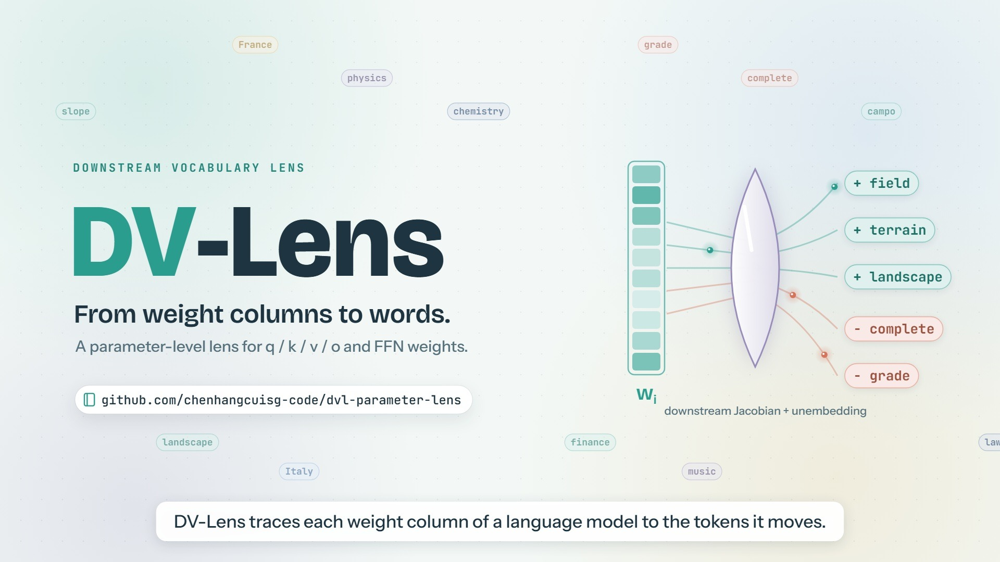

<div align="center">

# DV-Lens: Revealing the Functional Organization of Language Model Parameters

Chenhang Cui, Jian Yu, Shuyi Miao, Xiaohao Liu, Rui Huang, Fei Shen, An Zhang, Tat-Seng Chua

<a href="https://arxiv.org/abs/2610.04489"></a>
<a href="https://arxiv.org/pdf/2610.04489"></a>
<a href="LICENSE"></a>

<a href="https://github.com/chenhangcuisg-code/DV-Lens/actions/workflows/checks.yml"></a>

**[Paper](https://arxiv.org/abs/2610.04489)** · **[Video](docs/VIDEO.md)** · **[Method](#method)** · **[Quick start](#quick-start)** · **[Outputs](#outputs)** · **[Release scope](#release-scope)** · **[Citation](#citation)**

</div>

## TL;DR

**DV-Lens connects native parameter columns to downstream vocabulary responses.** It estimates a separate downstream Jacobian for each attention Q/K/V/O projection and FFN down projection, transports the columns through that mapping, and reads them through the language-model head. The resulting signed readouts describe local vocabulary directions. **DV-Complexity** groups columns in this output geometry and measures the reconstruction residual of the original weights within those groups.

This repository releases the **main method implementation**: dense and sketched Jacobian estimation, vocabulary readout, and DV-Complexity. See [Release scope](#release-scope) for the exact boundary.

## News

- **2026-10-20** · Main method code, portable commands, and CPU checks released.
- **2026-10-03** · [Paper](https://arxiv.org/abs/2610.04489) released on arXiv.

## Video

[](docs/VIDEO.md)

**[Watch the introduction](docs/VIDEO.md)** · [720p MP4](assets/video/dvlens_promo_720p.mp4) · [1080p MP4](assets/video/dvlens_promo_1080p.mp4)

The original silent, captioned film introduces the readout, validation, parameter interventions, and DV-Complexity. Its final repository-tour chapters show the earlier research archive; this public repository releases the main method code as described in [Release scope](#release-scope).

## Method

For a native weight matrix $`W_m \in \mathbb{R}^{d_m\times n_m}`$, let $`\bar J_m`$ be the reference-prompt average downstream Jacobian from that module's output to the final decoder-block output. The implemented frozen output readout is

```math
r_{m,i} = W_U\,\Gamma\,\bar J_m\,W_m[:,i],
\qquad H=\Gamma W_U^\top W_U\Gamma.
```

Here $`W_U`$ is the unembedding and $`\Gamma`$ contains the learned scale of the final normalization. The readout is signed and linear; its entries are vocabulary coordinates, not probabilities. The frozen output metric approximates final normalization and does not include its full input-dependent derivative.

| Step | Computation | Implementation |
|---|---|---|
| Estimate downstream maps | Average module-output VJPs over reference prompts and retained token positions | `code/exact.py`, `code/sketch.py` |
| Construct output coordinates | Dense: $`H^{1/2}\bar J_mW_m`$, up to an orthogonal change of basis and a common scale; sketch: a fixed Gaussian projection of these coordinates | `output_metric_coordinates`, `build_output_sketch` |
| Group native columns | Seeded k-means on output coordinates, with no per-column unit normalization | `code/kmeans.py` |
| Measure structural variation | Relative centroid reconstruction SSE of the original weight columns, using the fixed output-space labels | `relative_sse_for_labels` |
| Inspect vocabulary directions | Largest and smallest signed coordinates for selected columns from a dense fit | `examples/read_columns.py` |

For labels $`z_i`$ and raw-weight centroids $`\mu_k`$, the per-matrix score is

```math
\mathrm{DVComplexity}(W_m,z)
=\frac{\sum_i\lVert W_m[:,i]-\mu_{z_i}\rVert_2^2}
       {\sum_i\lVert W_m[:,i]\rVert_2^2}.
```

The Joint score is the arithmetic mean of the per-matrix scores, giving each matrix equal weight. A larger residual means greater within-group variation under the chosen partition; it is not an independently calibrated capability predictor.

See [implementation notes](docs/IMPLEMENTATION.md) for estimator details, module coverage, numerical conventions, and cache behavior.

## Quick start

### Installation

Use Python 3.10 or later. Install a PyTorch build appropriate for your machine, then install the remaining dependencies. The Jacobian Lens adapter is pinned to a specific commit in `requirements.txt`.

```bash
git clone https://github.com/chenhangcuisg-code/DV-Lens.git
cd DV-Lens
python -m venv .venv
source .venv/bin/activate
pip install torch
pip install -r requirements.txt
```

On Windows PowerShell, activate with `.\.venv\Scripts\Activate.ps1`. For CUDA, select the appropriate wheel using the [PyTorch installation instructions](https://pytorch.org/get-started/locally/). Model fitting loads one model onto the selected device. Large checkpoints require sufficient GPU memory; a synthetic CPU example is available below.

### 1. Run without a model download

```bash
python examples/tensor_readout.py
python -m unittest discover -s tests -v
```

The example constructs synthetic matrices, clusters their output coordinates, computes DV-Complexity, and produces signed vocabulary coordinates. The tests check the numerical contracts against explicit matrix calculations and an analytic downstream map.

### 2. Prepare reference text

Supply your own JSONL corpus, with a `text` string or a `texts` list per line:

```json
{"text": "A sufficiently long passage of reference text goes here."}
{"texts": ["Another passage.", "A further passage."]}
```

The loader deterministically joins successive entries until the tokenizer reaches `--max_seq_len`, truncates that sequence, then starts a new sequence. Provide enough text for `--fit_n` full sequences. No corpus or pretrained weights are distributed here.

`--model` accepts a Hugging Face identifier or a local checkpoint directory. For gated checkpoints, authenticate through Hugging Face. These entry points retain `trust_remote_code=True` for architecture compatibility; use checkpoints whose model code you trust. Use a fixed local snapshot when you need a stable model revision.

### 3. Fit dense Jacobians

The following is a small functional run on layer 0, suitable for inspecting the workflow. Replace `reference.jsonl` with your own corpus.

```bash
python code/exact.py \
  --model Qwen/Qwen3-0.6B --safe qwen3-0.6b \
  --fit_corpus_jsonl reference.jsonl --fit_n 4 \
  --layer_indices 0 --max_seq_len 128 --skip_first 16 \
  --dim_batch 8 --dtype fp32 --device cuda \
  --k 32 --iters 12 --seed 0 \
  --cache_dir outputs/cache/exact --out outputs/exact.jsonl
```

Dense fitting stores each module Jacobian and the eigendecomposition of the output metric. `--n_layers 0` selects every eligible layer. The implementation excludes the final decoder layer from the target set; indices are zero-based. The fit prints its cache location and also records it as `cache_path` in the output JSONL.

### 4. Read selected columns

Use the `cache_path` produced by the dense run and a `module` path from its `matrix_records`:

```bash
python examples/read_columns.py \
  --model Qwen/Qwen3-0.6B \
  --cache outputs/cache/exact/qwen3-0.6b/REPLACE_WITH_CACHE_HASH \
  --layer 0 --module self_attn.q_proj --columns 0,1 --topk 10 \
  --device cpu --out outputs/readout.json
```

The output lists both vocabulary tails, including token IDs, decoded tokens, and signed values. Selected-column readouts use the dense cache; the projected sketch cache does not retain enough information to recover the full signed vocabulary vector.

### 5. Use the scalable sketch path

```bash
python code/sketch.py \
  --model Qwen/Qwen3-0.6B --safe qwen3-0.6b \
  --fit_corpus_jsonl reference.jsonl --fit_n 2000 \
  --n_layers 0 --max_seq_len 128 --skip_first 16 \
  --sketch_dim 128 --sketch_seed 314159 \
  --layer_group_size 8 --dim_batch 16 --dtype bf16 --device cuda \
  --k 32 --iters 12 --seed 0 \
  --cache_dir outputs/cache/sketch --out outputs/sketch.jsonl
```

This shares a forward graph and VJP passes across target modules in each layer group. It stores projected maps instead of dense Jacobians. Reduce `--layer_group_size` or `--dim_batch` if activation memory is limiting. A sketch is an approximation; its partitions and scores can differ from a dense run.

## Outputs

Each completed fit appends one JSON object to the requested JSONL file. Repeated invocations append additional records; caches are stored separately under the selected cache root.

| Field | Meaning |
|---|---|
| `matrix_records` | Per-layer module paths, categories, shapes, prompts used, and scores |
| `km_jassign_raw` | Per-matrix DV-Complexity: raw-weight relative SSE under output-space labels |
| `km_raw` | Raw-weight k-means reference score |
| `km_jassign_lens` | Relative SSE in the output coordinates, a separate diagnostic |
| `km_path_a_jwl_qkvo_ffn` | Joint DV-Complexity over all selected matrices |
| `km_jwl_qkvo`, `km_jwl_ffn` | Attention-only and FFN-only means |
| `km_path_b_ffn_jwl_qkvo_raw` | Hybrid diagnostic: output-space labels for FFN, raw labels for attention |
| `cache_path` | Configuration-specific tensor cache and manifest |

The legacy `jwl` field names are retained to preserve numerical compatibility with the original method implementation. All aggregate scores are unweighted means over the matrices in the actual run, not over a fixed external benchmark cohort.

## Repository layout

| Path | Contents |
|---|---|
| `code/exact.py` | Dense downstream Jacobians, module discovery, output geometry, aggregation |
| `code/sketch.py` | Shared layer-group VJPs and Gaussian output-metric sketch |
| `code/geometry.py` | Signed readout, fixed-label SSE, clustering wrapper, tensor I/O |
| `code/kmeans.py` | Seeded tensor k-means |
| `examples/` | Synthetic CPU example and selected-column vocabulary export |
| `tests/` | Numerical checks and offline tiny-Llama CLI smoke test |
| `docs/IMPLEMENTATION.md` | Estimator conventions and validation boundary |
| `docs/RELEASE_SCOPE.md` | Included and excluded release contents |
| `RELEASE_MANIFEST.tsv` | Payload file sizes and SHA-256 checksums |

## Release scope

This is a **method-code release**, with a fresh public history. It includes only the implementation and the documentation, examples, dependency declarations, license, and checks needed to use it.

The release does not distribute benchmark data or results, intervention experiments, evaluation cohorts, paper sources or figure-generation pipelines, model weights, Jacobian caches, raw logs, server launchers, or development history. It does not provide commands to reproduce the paper's full experimental matrix. See [the paper](https://arxiv.org/abs/2610.04489) for the experimental study.

## Validation

```bash
python -m unittest discover -s tests -v
python tests/smoke_hf.py
```

The second command creates a randomly initialized tiny Llama and tokenizer in a temporary directory and runs dense fitting, sketch fitting, and signed vocabulary export entirely offline. It does not download a pretrained model. CPU checks were run with Python 3.12, PyTorch 2.12.0+cpu, Transformers 5.10.2, NumPy 2.4.3, and the pinned Jacobian Lens dependency. Full-size GPU fitting and the paper's benchmarks were not rerun for this release.

## Citation

```bibtex
@misc{cui2026dvlens,
  title={DV-Lens: Revealing the Functional Organization of Language Model Parameters},
  author={Chenhang Cui and Jian Yu and Shuyi Miao and Xiaohao Liu and Rui Huang and Fei Shen and An Zhang and Tat-Seng Chua},
  year={2026},
  eprint={2610.04489},
  archivePrefix={arXiv},
  primaryClass={cs.CL},
  url={https://arxiv.org/abs/2610.04489}
}
```

## Acknowledgments and license

The implementation uses the Hugging Face model-layout adapter from [Jacobian Lens](https://github.com/anthropics/jacobian-lens). See [third-party notices](THIRD_PARTY_NOTICES.md) for the dependency and attribution boundary.

DV-Lens code is released under [BSD-3-Clause-Clear](LICENSE). Dependencies, models, tokenizers, and reference corpora retain their respective licenses.
